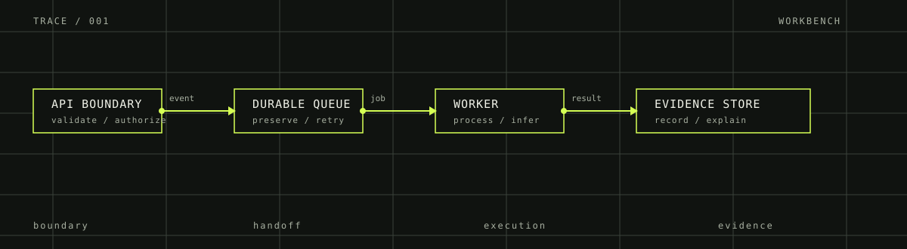

ATHARVA WARANKAR / SOFTWARE ENGINEER / 01—SYSTEMS WORKBENCH

# I build the parts that make software work.

APIs, asynchronous workflows, and developer tools built with 
enough product sense to survive contact with real users.

 

[GitHub](https://github.com/atharvaworkx) · [LinkedIn](https://linkedin.com/in/atharwaw01) · [Email](mailto:atharva.workx@gmail.com)

 

 

> **A useful constraint:** every visual here describes something I actually build.

---

## 02 / What I work on

I design backend systems where the interesting work happens between the request and
the result: authentication boundaries, durable jobs, integrations, diagnostics,
and evidence that lets a person understand what happened.

My current focus is **Python backends**, **REST APIs**, **event-driven processing**,
and careful **AI integrations** that have a deterministic path when the model or
network is unavailable.

`Python` `Django` `Django REST Framework` `PostgreSQL` `Redis` `Celery` `Docker` `React` `TypeScript`

---

## 03 / Selected work

### RED THREAD

**A privacy-first OSINT research engine for turning open questions into traceable dossiers.**

Red Thread concurrently ingests public sources, fingerprints source content, extracts
entities and assertions, then binds generated claims back to evidence. It uses local
Ollama inference when available and a deterministic synthesis path when it is not.

`Django` `DRF` `React` `TypeScript` `Ollama` `ReportLab`

**The detail worth inspecting:** SSRF-aware ingestion, SHA-256 content auditing,
citation binding, and local PDF archival are treated as one evidence pipeline.

[Backend repository](https://github.com/atharvaworkx/Red_Thread-Backend) ·
[Interface repository](https://github.com/atharvaworkx/Red_Thread-UI)

 

### POCKETOPS

**A developer tool for collecting safe, useful diagnostics from Django and DRF services.**

PocketOps provides a drop-in exception handler that classifies failures and sends
diagnostic events asynchronously. The integration deliberately excludes stack traces,
SQL, credentials, and raw exception text from its reporting payload.

`Django` `DRF` `PostgreSQL` `httpx` `Flutter`

**The detail worth inspecting:** fire-and-forget delivery is isolated from the
request path, while the safe event schema keeps debugging useful without turning
an observability service into a data leak.

[Backend repository](https://github.com/atharvaworkx/PocketOps) ·
[Flutter client](https://github.com/atharvaworkx/PocketOps_App)

 

### AYUPILOT

**An Ayurvedic healthcare management product with a React/TypeScript interface and Django REST backend.**

The system explores patient and practice workflows, asynchronous processing, and
AI-assisted product features. I keep the distinction between shipped flows and
unfinished integrations visible rather than presenting a concept as a finished product.

`React` `TypeScript` `Django` `DRF`

[Dashboard repository](https://github.com/atharvaworkx/Ayupilot-_Dashboard)

 

### RIPPLE

**In progress.**

The public deployment, screenshots, and technical notes will be added after the first
build is ready. No placeholder interface is pretending to be evidence.

---

## 04 / Working notes

**Reliable APIs** — explicit boundaries, safe failure modes, and integrations that
do not become the least observable part of a system.

**Asynchronous by design** — move expensive work out of the request path, preserve
state, and make the hand-off inspectable.

**AI with a floor** — use models where they help, but keep deterministic behavior
for offline, constrained, or reproducibility-sensitive paths.

---

## 05 / Elsewhere

I am interested in developer tools, backend platforms, intelligent workflows, and
small products with unusually careful engineering.

[atharvaworkx on GitHub](https://github.com/atharvaworkx) ·
[atharwaw01 on LinkedIn](https://linkedin.com/in/atharwaw01) ·
[atharva.workx@gmail.com](mailto:atharva.workx@gmail.com)

 

BUILT WITH RESTRAINT · DOCUMENTED WITH EVIDENCE · OPEN TO USEFUL PROBLEMS

