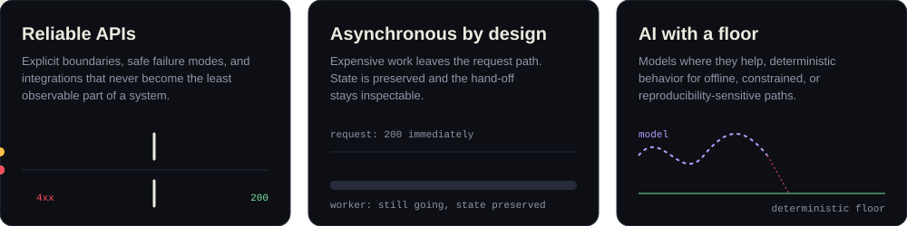
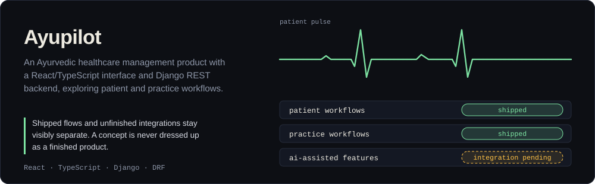
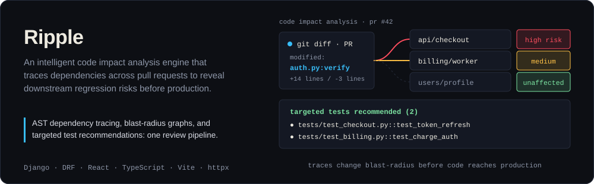
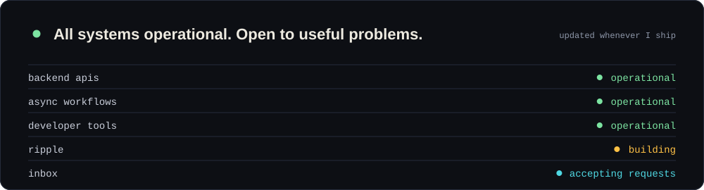

  

[GitHub](https://github.com/atharvaworkx) · [LinkedIn](https://linkedin.com/in/atharwaw01) · [Email](mailto:atharva.workx@gmail.com)

 

 

Driven by curiosity, built on first principles, and fueled by the pursuit of what's possible. Exploring ideas, engineering solutions, and turning complex challenges into something meaningful.

 

 

## Selected work

[Backend](https://github.com/atharvaworkx/Red_Thread-Backend) · [Interface](https://github.com/atharvaworkx/Red_Thread-UI)

 

[Backend](https://github.com/atharvaworkx/PocketOps) · [Flutter client](https://github.com/atharvaworkx/PocketOps_App)

 

[Dashboard](https://github.com/atharvaworkx/Ayupilot-_Dashboard)

 

 

